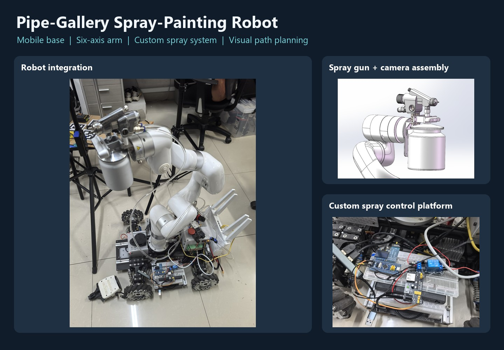
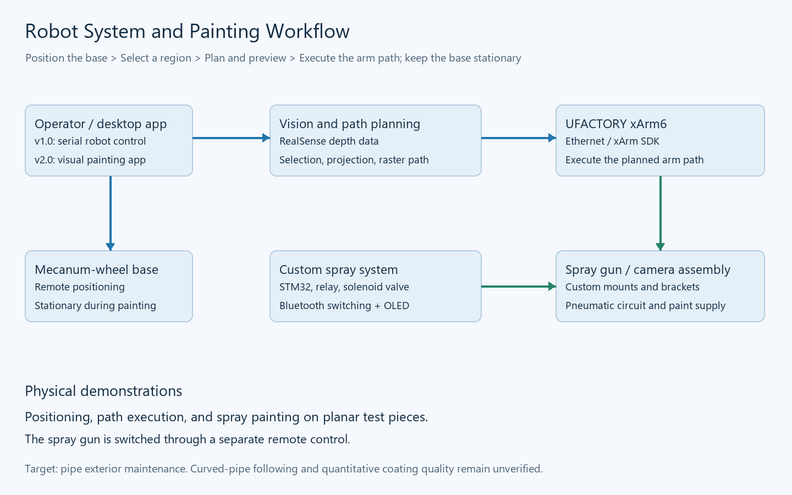
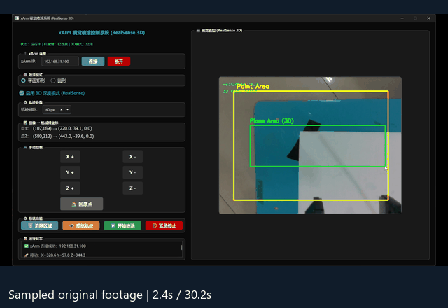
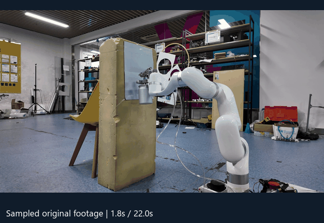
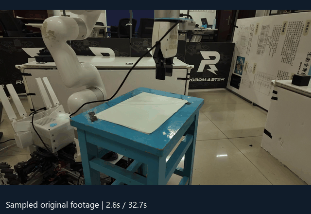
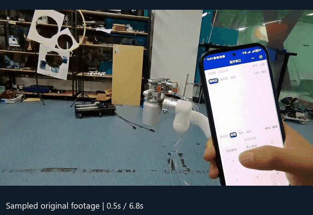

<div align="center">

**English** | [简体中文](README.zh-CN.md)

# Compact Spray-Painting Robot for Pipe Galleries

**Design and Implementation of a Mobile Robot for Pipe Exterior Maintenance**

Mecanum-wheel base · xArm6 manipulator · Custom spray system · Vision-guided path planning

[Contributions](#my-contributions) · [Demonstrations](#physical-demonstrations) · [Quick Start](#quick-start) · [Software Guide](docs/software.md) · [Hardware](hardware/README.md)

</div>



## Overview

This project develops a compact spray-painting robot for maintaining pipe exteriors in pipe galleries, where limited space and complex pipe layouts make manual maintenance difficult. The system integrates a mecanum-wheel mobile base, a UFACTORY xArm6 six-axis manipulator, a custom spray-painting system, and Python desktop control software.

The operator remotely positions the base, selects a target region in the end-effector camera image, previews a generated painting path, and commands the manipulator to execute it. **The base remains stationary during painting, and the spray gun is switched through a separate remote control.**

Positioning, path execution, and physical spray painting have been demonstrated on planar test pieces. The repository includes historical software, a user manual, SolidWorks parts and assemblies, photographs, and demonstration previews. Curved-pipe orientation following, deployment in an operating pipe gallery, and quantitative coating-quality evaluation require further experiments.

## My Contributions

| Area | Work | Supporting materials |
| --- | --- | --- |
| **Custom spray system** | Spray-gun mounting and brackets, pneumatic circuit, paint supply, electrical control platform, and wireless control integration | [Hardware notes](hardware/README.md), [SolidWorks models](hardware/solidworks), [pneumatic diagram in English](docs/images/pneumatic-en.png) |
| **Embedded control integration** | STM32F103RCT6 control signals drive a relay to switch a solenoid valve; Bluetooth and an OLED display were added later | [Control diagram](docs/images/electrical-control-en.png), [Bluetooth demonstration](docs/previews/bluetooth-en.gif) |
| **Robot control application** | Python / PyQt5 software combining two camera feeds, base teleoperation, joint controls, region selection, and area calculation over a serial interface | [Original v1.0](archive/original-software/喷漆机器人控制平台v1.0.py), [original user manual](docs/user-manual-v1.pdf) |
| **Vision-guided path planning** | Python / PySide6 application using RealSense depth data and the xArm network SDK for raster path generation, preview, and execution | [Original v2.0](archive/original-software/喷漆机器人控制平台v2.0.py), [curated application](software/v2.py) |

The mobile base and xArm6 serve as integration platforms. My primary design and development work covers the spray system, end-effector assembly, supervisory software, and visual painting algorithms.

## System Architecture



| Subsystem | Configuration and role |
| --- | --- |
| Mobile base | Mecanum wheels for remotely positioning the robot |
| Manipulator | UFACTORY xArm6 for six-axis positioning and path execution |
| Vision | Base and end-effector camera feeds in the overall system; an end-effector RealSense RGB-D camera in the v2.0 application |
| Spray equipment | Spray gun, paint supply, atomization and control air lines, and solenoid valve |
| Embedded control | STM32F103RCT6, relay, Bluetooth module, and OLED display |
| Desktop software | Serial robot control in v1.0; dedicated vision-guided painting over Ethernet in v2.0 |

## Physical Demonstrations

These GIFs sample frames from the original videos for a quick preview. Added captions are in English; the recorded desktop and mobile interfaces retain their original Chinese labels. Timestamps at the bottom indicate the source-video time; the animations do not represent real-time execution speed. See the [media index](docs/gallery.md) and [upload guide](docs/upload-guide.md) for original filenames and attachment handling.

### Region Selection, Path Preview, and Manipulator Execution



### Spray Painting on a Planar Test Piece



| Positioning demonstration | Bluetooth spray-gun control |
| --- | --- |
|  |  |

## Software Evolution

| Feature | v1.0: Robot Control Platform | v2.0: Vision-Guided Painting Application |
| --- | --- | --- |
| UI framework | PyQt5 | PySide6 |
| Communication | Custom serial commands | xArm Python SDK over Ethernet |
| Video | End-effector and base camera feeds | End-effector RealSense color and depth data |
| Manual controls | Base motion and six joint controls | Manipulator XYZ jogging and homing |
| Vision functions | Region selection, calibration loading, and area calculation in planar / cylindrical modes | Depth-assisted coordinate mapping, path generation, preview, and execution |
| Painting commands | Sends task parameters | Rectangular raster paths; an additional concentric-circle selection mode |
| Project records | **Software copyright registration applied for**, with the original user manual | Later UI and planning improvements |

v2.0 is a standalone application dedicated to visual painting; the base is controlled separately. Its circular selection mode describes a circular image region, not cylindrical-pipe surface following.

**Historical sources and curated applications are stored separately.** This repository adds shared configuration, offline previews, and explicit error handling, and fixes UI and execution issues. The original source files are preserved byte for byte with a [SHA-256 manifest](archive/source-manifest.json). See the [change log](CHANGELOG.md) for the curation changes.

## Quick Start

Recommended environment: Windows 10 / 11 and Python 3.10. Run the following PowerShell commands from the repository root; virtual-environment activation is not required.

```powershell
python -m venv .venv
.\.venv\Scripts\python.exe -m pip install -r requirements-v2.txt
.\.venv\Scripts\python.exe run.py --version v2 --offline
```

Offline mode opens the interface and provides 2D path previews without connecting cameras, serial devices, or a robot. Click two opposite corners of a rectangle inside the yellow boundary, then click **预览轨迹** (Preview Path). The desktop interface currently uses Chinese labels.

To open the v1.0 interface offline:

```powershell
.\.venv\Scripts\python.exe -m pip install -r requirements-v1.txt
.\.venv\Scripts\python.exe run.py --version v1 --offline
```

For hardware dependencies, device connections, configuration, and calibration requirements, see the [software guide](docs/software.md). Coordinate mapping values come from the original experimental setup and must be reviewed for the actual assembly. The default `mapping_reviewed` setting is `false`; the curated v2.0 application does not connect to the manipulator until it is reviewed.

Run the hardware-independent tests:

```powershell
.\.venv\Scripts\python.exe -m unittest discover -s tests -v
```

The detailed software guide, hardware notes, original manual, and validation records are currently in Chinese.

## Validation and Available Materials

- **Original physical demonstrations:** planar spray painting, visual positioning and path execution, and separate Bluetooth spray-gun switching.
- **Repository software checks:** offline path and failure-state tests, UI startup, and interaction checks. See the [validation record](docs/validation.md). The curated software has not been retested on physical hardware.
- **Available materials:** original Python sources, user manual, SolidWorks parts and assemblies, photographs, and videos. STM32 firmware, mobile-client source code, and complete electrical wiring documentation were not retained.
- **Diagrams:** an English rendering of the original pneumatic schematic is provided alongside the source artifact. The electrical control diagram was reconstructed from the project description; unknown component specifications and pin assignments are not inferred.

## Repository Structure

```text
├── README.md                   # English project overview
├── README.zh-CN.md             # Chinese project overview
├── run.py                      # Shared launcher for curated applications
├── software/                   # v1 / v2 interfaces, planning, and execution
├── config/                     # Configuration based on the original setup
├── archive/                    # Historical sources and checksum manifest
├── hardware/solidworks/               # SolidWorks parts and assemblies
├── docs/                       # Manual, guides, images, previews, and validation
├── tests/                      # Offline tests
└── tools/                      # Media generation, checks, and local packaging
```

Original videos and the purchased manipulator's reference model are kept as separate attachments. The local `release-assets/` directory is excluded from Git and the source upload package.

---

Author: **NeoWang213**. No open-source license has been specified. Third-party equipment, SDKs, and reference models remain subject to their respective rights. See [NOTICE.md](NOTICE.md).
