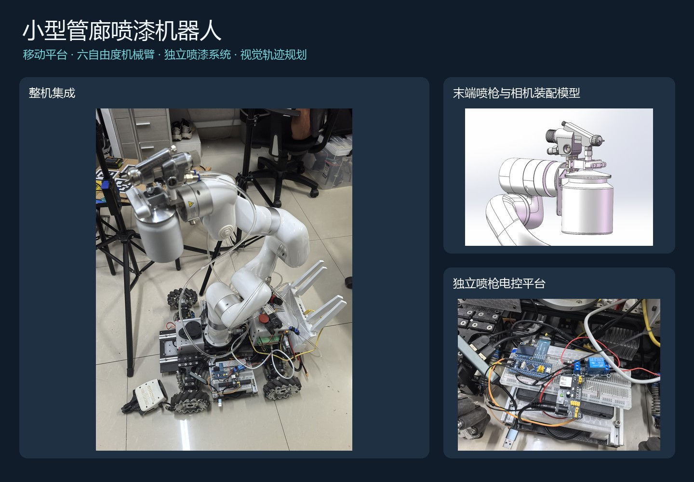
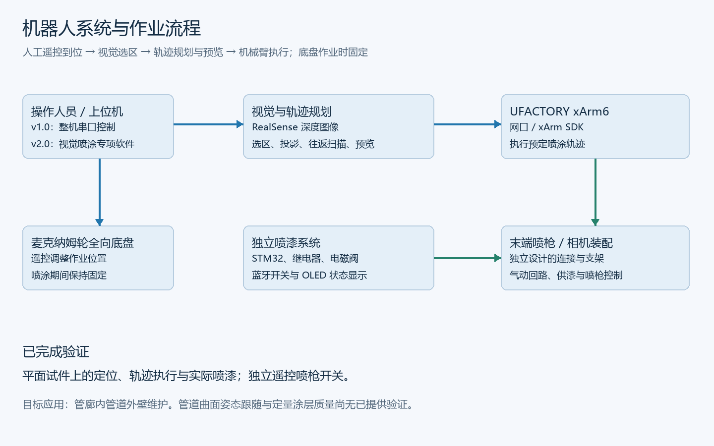
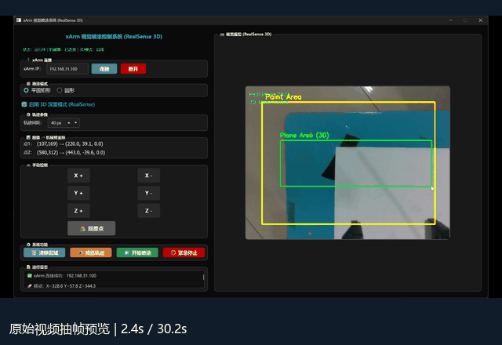
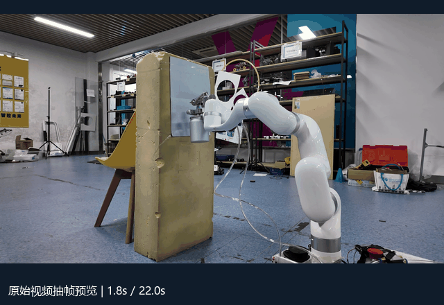
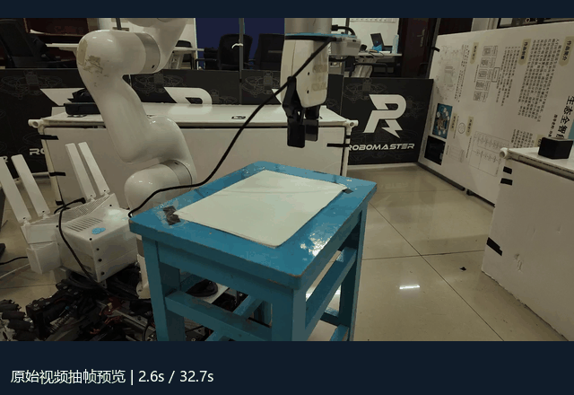
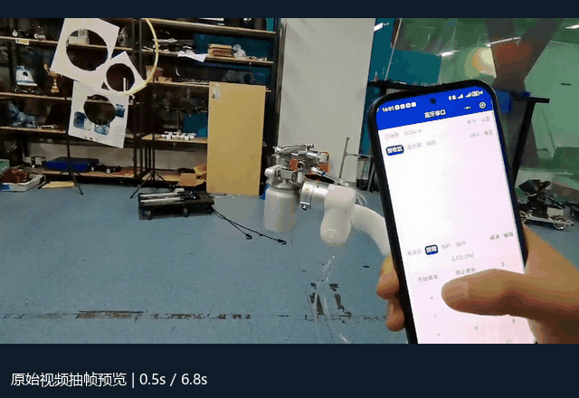

<div align="center">

[English](README.md) | **简体中文**

# 小型管廊喷漆机器人的设计与实现

**Compact Spray-Painting Robot for Pipe Galleries**

全向移动平台 · xArm6 机械臂 · 独立喷漆系统 · 视觉选区与轨迹规划

[项目贡献](#个人主要工作) · [实物演示](#实物演示) · [软件运行](#快速开始) · [技术说明](docs/software.md) · [硬件设计](hardware/README.md)

</div>



## 项目简介

针对管廊空间受限、管线布置复杂、人工喷漆维护作业不便等问题，设计并实现一套小型管廊喷漆机器人系统。系统集成麦克纳姆轮全向移动底盘、UFACTORY xArm6 六自由度机械臂、独立设计的喷漆系统及 Python 上位机软件，探索以远程操作与视觉辅助自主作业完成管道外壁的喷漆维护。

作业时，操作人员先遥控底盘到达目标位置，再在末端相机画面中选取区域，由软件生成并预览喷涂轨迹，控制机械臂执行。**底盘在喷涂期间保持固定，喷枪通过独立遥控开关控制。**

已完成平面试件上的定位、轨迹执行与实际喷漆验证，并保留了原始视频、软件、用户手册和装配模型。现有验证支持实验原型展示；管道曲面姿态跟随、现场管廊作业与涂层质量的定量评估仍需后续实验。

## 个人主要工作

| 工作方向 | 具体内容 | 对应材料 |
| --- | --- | --- |
| **独立喷漆系统设计** | 喷枪安装与支架、气动回路、供漆装置、电控平台及无线控制 | [硬件说明](hardware/README.md)、[SolidWorks 模型](hardware/solidworks)、[气动原理图](docs/images/pneumatic-original.png) |
| **嵌入式控制集成** | STM32F103RCT6 输出控制信号，经继电器控制电磁阀通断；后期增加蓝牙与 OLED | [电控示意图](docs/images/electrical-control.png)、[蓝牙演示](docs/previews/bluetooth.gif) |
| **整机上位机开发** | Python / PyQt5 串口控制平台，整合双路视频、底盘遥控、机械臂关节控制、选区与面积计算 | [v1.0 原始代码](archive/original-software/喷漆机器人控制平台v1.0.py)、[原用户手册](docs/user-manual-v1.pdf) |
| **视觉轨迹规划开发** | Python / PySide6 专项软件，接入 RealSense 深度图像与 xArm 网口控制，增加往返扫描、轨迹预览和执行 | [v2.0 原始代码](archive/original-software/喷漆机器人控制平台v2.0.py)、[整理版](software/v2.py) |

移动底盘与 xArm6 是系统集成平台。个人设计工作主要集中在喷漆系统、末端装配、上位机和视觉喷涂算法。

## 系统组成



| 子系统 | 配置与作用 |
| --- | --- |
| 全向移动底盘 | 麦克纳姆轮，遥控调整位置 |
| 机械臂 | UFACTORY xArm6，六自由度末端定位与轨迹执行 |
| 视觉 | 整机使用底盘与末端两路画面；v2.0 专项软件接入末端 RealSense RGB-D 相机 |
| 喷漆装置 | 喷枪、供漆装置、雾化与控制气路、电磁阀 |
| 电控平台 | STM32F103RCT6、继电器、蓝牙模块、OLED |
| 上位机 | v1.0 串口整机控制；v2.0 网口视觉喷涂专项软件 |

## 实物演示

以下 GIF 从原始视频抽帧制作，用于快速浏览，时间进度以画面底部标注为准。完整视频的文件名和上传方式见 [素材索引](docs/gallery.md) 与 [上传说明](docs/upload-guide.md)。

### 视觉选区、轨迹预览与机械臂执行



### 平面试件喷漆验证



| 定位验证 | 蓝牙遥控喷枪 |
| --- | --- |
|  |  |

## 软件版本演进

| 项目 | v1.0：整机控制平台 | v2.0：视觉喷涂专项软件 |
| --- | --- | --- |
| 界面框架 | PyQt5 | PySide6 |
| 通信 | 自定义串口指令 | xArm Python SDK / 网口 |
| 视频 | 末端、底盘双路画面 | 末端 RealSense 彩色与深度数据 |
| 遥控 | 底盘移动、六关节控制 | 机械臂 XYZ 点动与回原点 |
| 视觉功能 | 选区、标定参数加载、平面 / 圆柱模式面积计算 | 深度辅助坐标映射、轨迹生成、预览与执行 |
| 轨迹 | 下发作业参数 | 矩形往返扫描；另保留同心圆选区模式 |
| 项目材料 | **已申请软件著作权**，配有原用户手册 | 后期功能扩展版本 |

v2.0 是独立使用的专项软件，底盘另行遥控。圆形选区模式表示图像中的圆形区域，并不等同于管道圆柱曲面跟随。

**整理版与原始成果分开保存。** 本次整理加入统一配置、离线预览和异常状态处理，修复界面与执行流程问题；原始代码逐字保留并提供 [SHA-256 校验清单](archive/source-manifest.json)。整理版改动见 [变更记录](CHANGELOG.md)。

## 快速开始

建议使用 Windows 10 / 11 和 Python 3.10，终端进入仓库根目录。以下命令使用 PowerShell，无需激活虚拟环境。

```powershell
python -m venv .venv
.\.venv\Scripts\python.exe -m pip install -r requirements-v2.txt
.\.venv\Scripts\python.exe run.py --version v2 --offline
```

离线模式展示界面与二维轨迹规划，不打开摄像头、串口或机械臂。依次点击黄色框内矩形的两个对角点，再点击“预览轨迹”。

运行 v1.0 离线界面：

```powershell
.\.venv\Scripts\python.exe -m pip install -r requirements-v1.txt
.\.venv\Scripts\python.exe run.py --version v1 --offline
```

接入实物的依赖、相机与机械臂连接、配置和标定要求见 [软件运行说明](docs/software.md)。配置文件中的坐标映射来自原实验设置，需要按实际装配重新核对；默认 `mapping_reviewed` 为 `false`，整理版 v2.0 此时不连接机械臂。

## 验证与材料边界

- **原项目实物验证**：平面试件喷漆、视觉定位与轨迹执行、独立蓝牙开关喷枪。
- **本次软件验证**：离线轨迹与故障状态测试、界面启动及交互检查，详见 [验证记录](docs/validation.md)。整理版尚未重新进行实物复测。
- **资料现状**：提供原始 Python 代码、用户手册、SolidWorks 模型、照片和视频。STM32 固件、手机端源码及完整电气接线资料未保留。
- **设计图说明**：气动图来自原项目；电控图按项目描述重绘，为原理示意，未推定未知器件参数。

## 目录

```text
├── run.py                      # 整理版统一启动入口
├── software/                   # v1 / v2 界面与离线规划、执行模块
├── config/                     # 原实验设置的集中配置
├── archive/                    # 原始脚本与校验清单
├── hardware/solidworks/               # SolidWorks 模型与装配体
├── docs/                       # 手册、运行说明、图像、预览和验证记录
├── tests/                      # 离线测试
└── tools/                      # 展示素材生成、检查与本地打包工具
```

完整视频及外购机械臂参考模型作为独立附件保留。工作目录中的 `release-assets/` 不进入 Git，也不进入源码上传包。


---

作者展示名：**NeoWang213**。本仓库暂未附开源许可证；第三方设备、SDK 与参考模型的权利归其各自权利人。详见 [材料与权利说明](NOTICE.md)。
