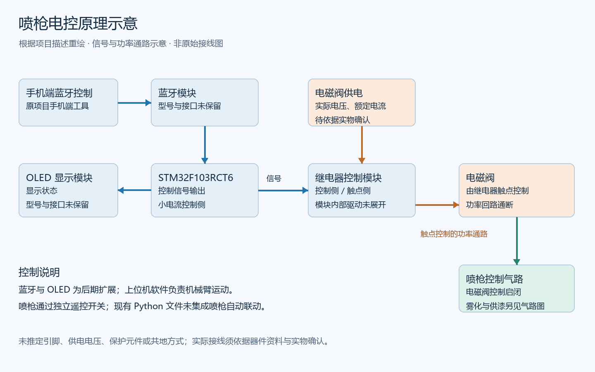
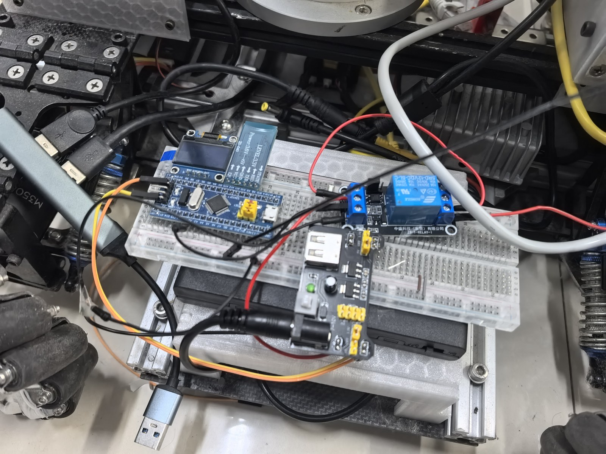
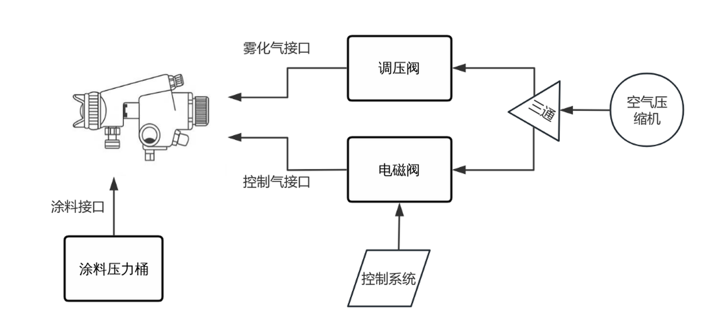
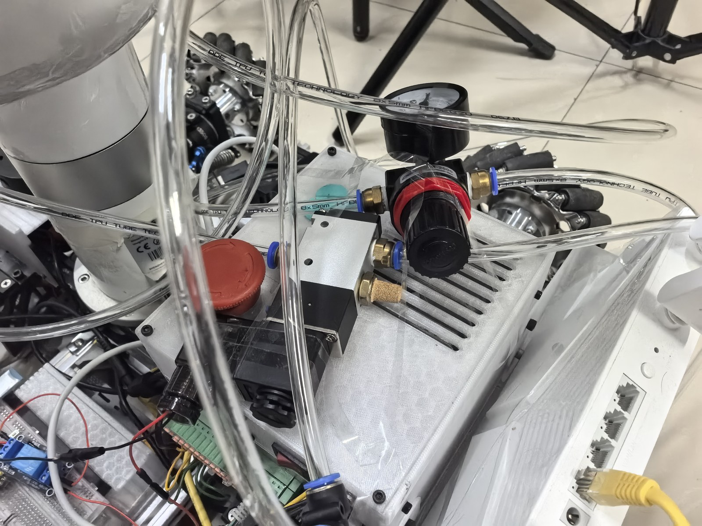
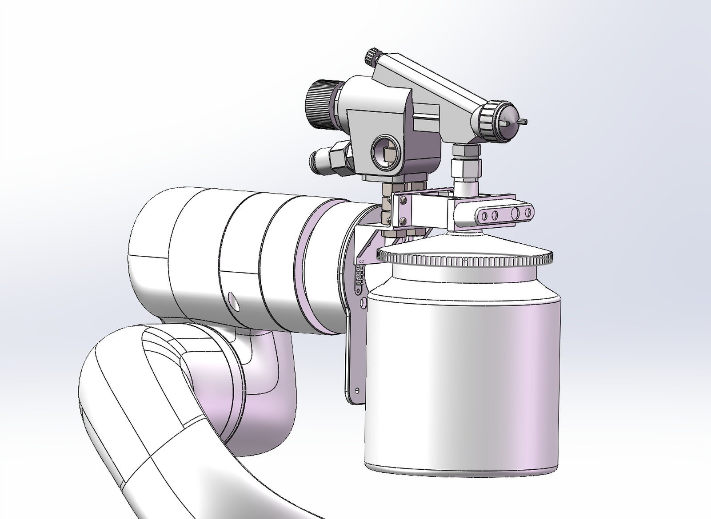

# 喷漆系统与末端装配

个人设计覆盖喷枪安装及连接支架、气动回路、供漆装置、电控平台与无线控制集成。底盘和 UFACTORY xArm6 作为集成平台使用。

## 电控

[可编辑 SVG](../docs/images/electrical-control.svg)

STM32F103RCT6 输出小电流控制信号，经继电器控制电磁阀功率回路通断，进而控制喷枪。后期加入蓝牙模块与 OLED，使用手机端工具遥控开关喷枪。

图中蓝色线表示控制与状态关联，棕色线表示继电器触点控制的功率通路，绿色线表示气路控制关系。图为根据项目描述重绘的功能示意，尚未复原原始逐引脚接线。继电器驱动、供电、保护元件、蓝牙和 OLED 型号等细节未保留，不依据照片推定。

## 气动与供漆

原图中，空气压缩机经三通分为雾化气路和控制气路：雾化支路经调压阀接喷枪雾化气接口；控制支路经电磁阀接控制气接口；涂料由压力桶接至涂料接口。具体装配以实际所用喷枪为准，提供的 SolidWorks 模型和照片用于记录不同部件及实验装配。

喷枪开关通过电磁阀控制。现有材料未给出喷幅和供漆流量的软件调节实现或标定数据，因此不将其列为软件闭环控制能力。

## SolidWorks 模型与来源

[`solidworks/`](solidworks) 保存原始 SolidWorks 零件与装配体，包括机械臂喷枪整体、摄像头支架、连接装配及组件模型。它们体现末端安装与装配设计，不表示喷枪、相机或机械臂本体均为自行制造。

装配体依赖相应零件与原有路径，换机后可能需要在 SolidWorks 中重新指定引用。现有材料未包含全部外部引用，尚未验证所有 SolidWorks 装配体的外部引用完整性。

外购机械臂参考压缩包 `xArm6(XF1305).zip` 中实际包含 `xArm6(XI1305).STEP`，原始命名差异按实记录。该模型作为第三方参考资料放在本地 `release-assets/`，不归入个人设计的 SolidWorks 模型。

## 资料现状

| 材料 | 状态 |
| --- | --- |
| 装配模型、平台照片、原始气动原理图 | 已提供 |
| 电控功能示意 | 根据项目描述重绘 |
| STM32 固件、手机端源码 | 未保留 |
| 蓝牙协议、完整电控接线、精确元件清单 | 未保留 |
| 流量、喷幅、气压与涂层厚度标定 | 未提供 |

缺失部分作为项目档案现状保留，不生成仿真固件或推定器件表。
